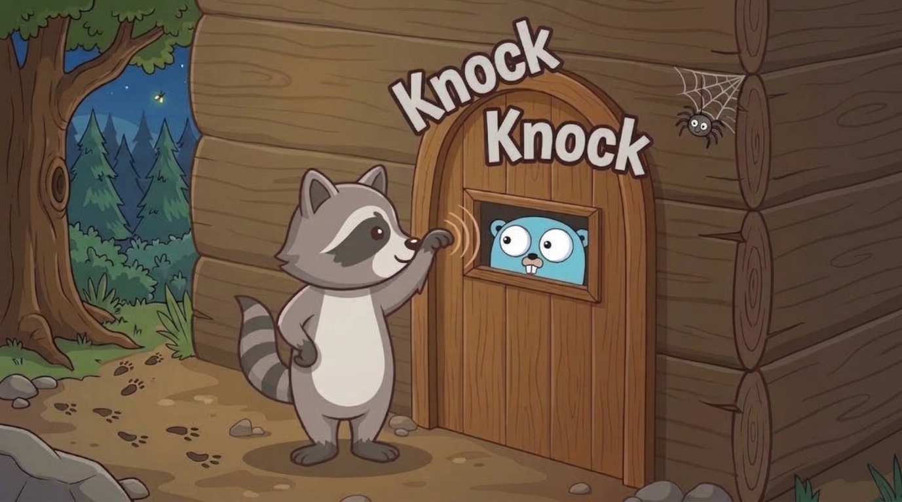
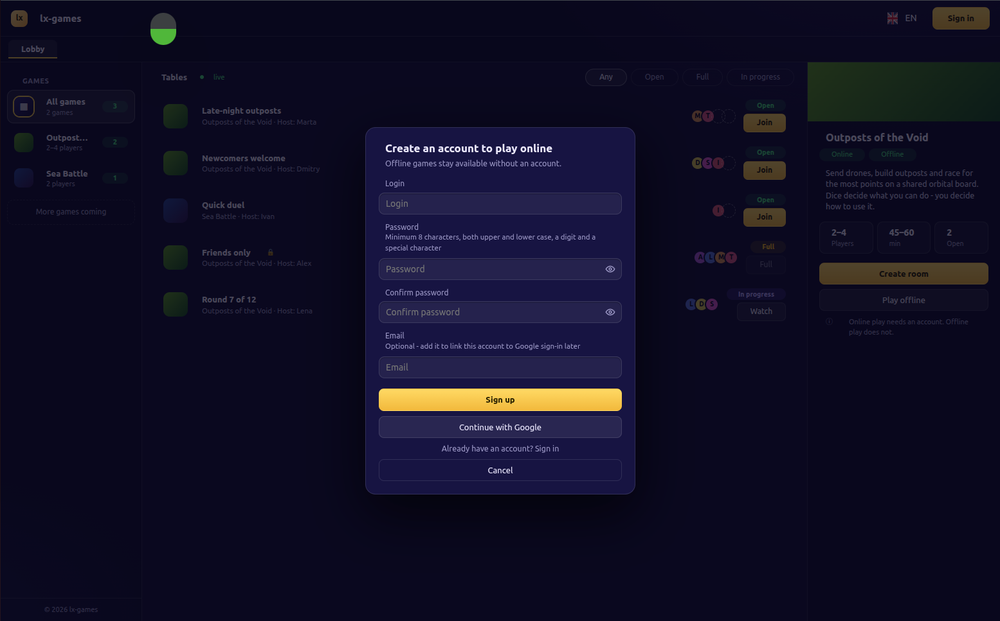
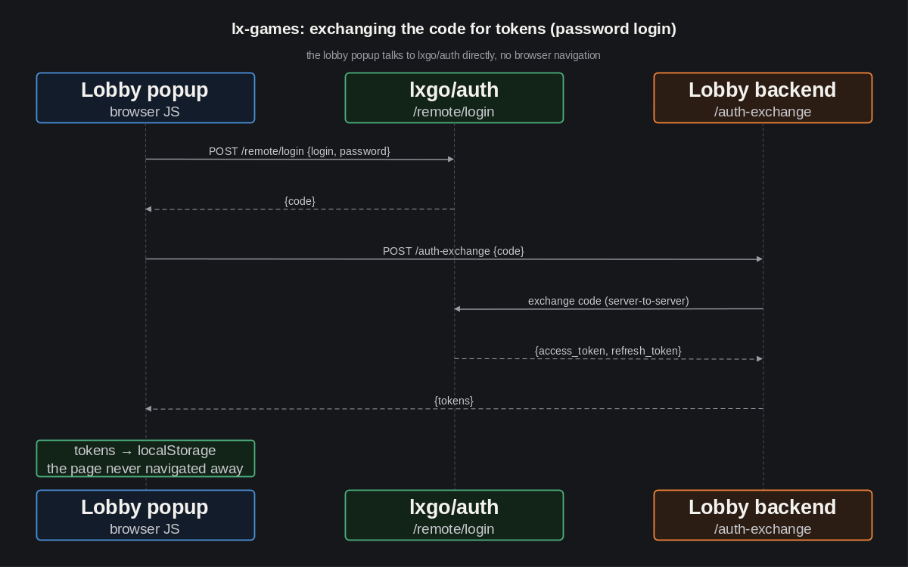

[LinkedIn](https://www.linkedin.com/pulse/lets-go-play-part-5-allow-me-introduce-myself-aleksei-sedov-tng1f/)

# Let's Go Play! Part 5: Allow Me to Introduce Myself...

---

> #### Epigraph
> *No rush - you'll get there soon enough.*

Greetings again!

[Last time](https://www.linkedin.com/pulse/lets-go-play-part-4-how-we-checked-our-own-intuition-aleksei-sedov-qmdnf/)
we took the first step toward online mode for Outposts of the Void: the
lobby and the cartridge already know how to talk to each other, all
that's left is syncing a match between players. Which means the work on
those very "players" had to start somewhere - and the obvious first step
is authorization. This report is about how a small "add a login" task
snowballed into its own microservice, and why I didn't stop that
snowball.

## A Fork at the Door

The task sounded simple: set up login/password authorization, plus, as
an alternative, a "Sign in with Google" button in the lobby's login
popup. I already had a reference for this - in my earlier projects that
kind of login was built right on the spot, with no separate
authorization service. I could have copied the same approach here -
fast, cheap, working code already exists.

But from the start I had this idea that `lx-games` should be integrated
with `lxgo/auth`, a package already sitting in the `lxgo` ecosystem.
It's a full-fledged authorization server that handles login/password,
but had never talked to any external provider. So I had a choice - bypass
`lxgo/auth` and build authorization straight into the lobby, the way I'd
done it before, or beef up `lxgo/auth` first and only then hook the
lobby up to a ready-made mechanism. Option one would close out the task
in an evening. Option two meant rewriting half the package, with no way
of knowing in advance where that would lead.

I picked the second option. Not because the first was wrong - it's a
perfectly solid choice, nothing to be ashamed of. It's just that if I
build it by hand in the lobby, it stays tied to the lobby. Whereas if I
improve `lxgo/auth`, the exact same mechanism becomes available to any
future service of mine that happens to need authorization. I'm paying
in complexity now so I don't have to pay it again every single time.

## The Snowball

As a result, the "small feature" didn't survive contact with reality.
Teaching `lxgo/auth` to talk to Google dragged in a whole bunch of
things the package never had before: email confirmation, a user status
(active/pending confirmation), and a separate component for sending mail
- which grew into a brand-new standalone package, `lxgo/mailer`.

A second problem surfaced in parallel. `lxgo/auth` only had one login
flow - a full browser redirect to its own form page. That's fine for a
classic website. For the lobby, which lives as an SPA and isn't supposed
to leave the page on login at all, that meant resetting all of its state
every single time a player just wanted to sign in. Solving that turned
into its own parallel epic - CORS preflight, redirect-free login,
exchanging an authorization code for tokens over JSON, and the actual
lobby integration. On top of that, working comfortably with yet another
microservice - `lxgo/auth` - called for some Docker tooling.

Two epics, dozens of tasks, a new package, a new microservice in the
project's architecture - all of it, in essence, for the sake of one
"Sign in with Google" button that could have been built in a single
evening.

## Two Logins, Two Solutions

In the end we got two different mechanisms - because password login and
Google login have different requirements.

Password login ended up needing no browser navigation at all: the
lobby's popup talks to `lxgo/auth` directly (CORS is already set up for
that), gets an authorization code straight back in the response, and
immediately exchanges it for tokens through the lobby's own handler. The
tokens land in `localStorage` - done, the page never went anywhere at
any step.

That doesn't work with Google - it has its own consent page, and
there's no avoiding a trip there. We considered a full popup setup with
a `postMessage` protocol between tabs, then dropped the idea: no point
inventing a whole message-passing protocol for the sake of one button.
The compromise we landed on: the entire Google flow opens in a new tab,
as a plain full-page redirect - while the original lobby tab stays
open, watches for tokens showing up in `localStorage`, and picks them
up as soon as the browser gives it focus back. The same trick,
incidentally, also handles clicking the link from the email
confirmation message.

## Claude and I Didn't See Eye to Eye

One moment here deserves its own story. The gist of the problem: to let
the browser ask the server for permission to make a cross-origin
request (the preliminary `OPTIONS` request that precedes the real
POST), something actually has to answer that `OPTIONS` request. In my
case, the `lxgo/kernel` router itself, before any middleware even ran,
was answering that request with `405 Method Not Allowed` - because only
POST was registered on that route. No setting inside `lxgo/cors` could
intercept this: the response fired off before that logic physically had
a chance to run.

To make this possible at all, I had to change the middleware handler's
signature across the entire framework - now a middleware can not just
pass a request along or abort it with an error, but also return a
ready-made response on its own.

This is where Claude and I diverged a little (a reminder: all of this
code gets written in exactly that kind of partnership). My electronic
colleague saw the situation as "a seemingly small edit at the
platform's most basic level - for the sake of one specific feature in
another one of its packages." It was uneasy about one question - "isn't
this too big a hammer for one nail?" - caution that's entirely
justified for code with real external consumers: touch a shared
signature, and who knows whose code breaks somewhere out there. But my
framework's only consumers, for now, are my own projects. Which means
the worry should be a different one: not "will I break someone," but
"am I missing a window that closes on its own the moment the first
external consumer shows up." As long as I'm in control of every bit of
dependent code, extending the base functionality and making the
platform more flexible is, to me, a straightforward good.

With Claude, it was enough to just point out the difference in context
- it turned out we weren't actually disagreeing about values, just
calibrated for different situations. We ended up agreeing: invest in
the platform now, while it's still cheap to do so.

## What's Next

This pass touched more than just `lx-games` itself - `lxgo/kernel`,
`lxgo/cors`, `lxgo/jspp`, `lxgo/session`, `lxgo/auth_client`, and
`lxgo/auth` all got their own changes. There's even a debutant -
`lxgo/mailer`. The lobby now has a real login popup instead of its old
placeholder.

The backlog grew too: for instance, there's currently no way to
manually merge two accounts if the same person managed to sign up by
password without giving an email, and then again through Google;
there's also no password-change mechanism yet. Along with a few other
things we'll get back to a bit later.

The next logical step is the mechanics of game rooms - players
interacting within the context of a room: creating games, joining as a
player or as a spectator, inviting people to private games. But the
main thing is that we now have players, and we're one step closer to
what all of this was for in the first place - Outposts of the Void is
getting ready to become genuinely multiplayer.

For convenience, here are the important links again:
* The framework - [https://github.com/epicoon/lxgo](https://github.com/epicoon/lxgo)
* The game engine - [https://github.com/epicoon/lx-games](https://github.com/epicoon/lx-games)

Thanks for reading - and, as always, I'll be glad to hear your comments
and questions `:)`
