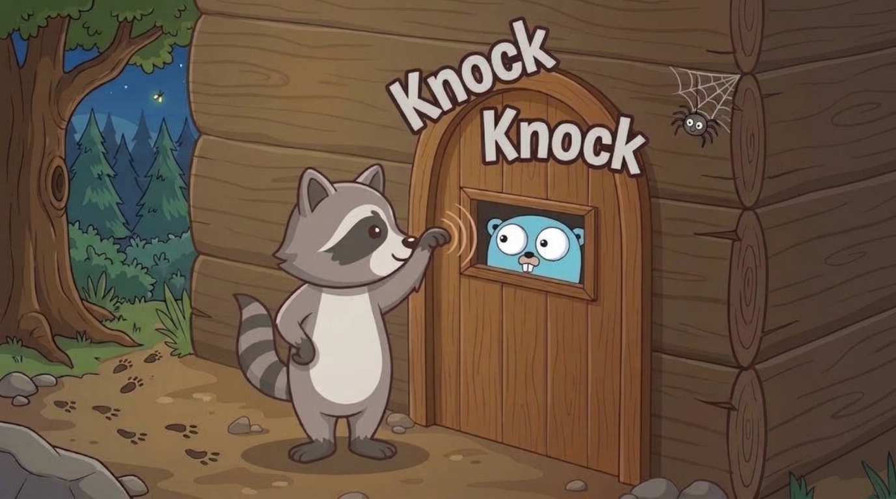
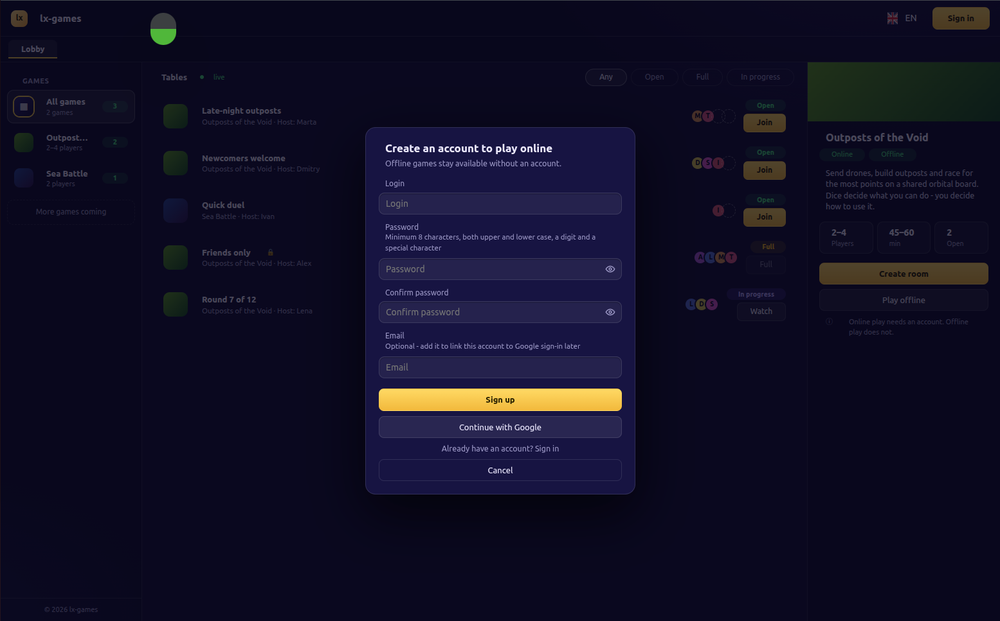
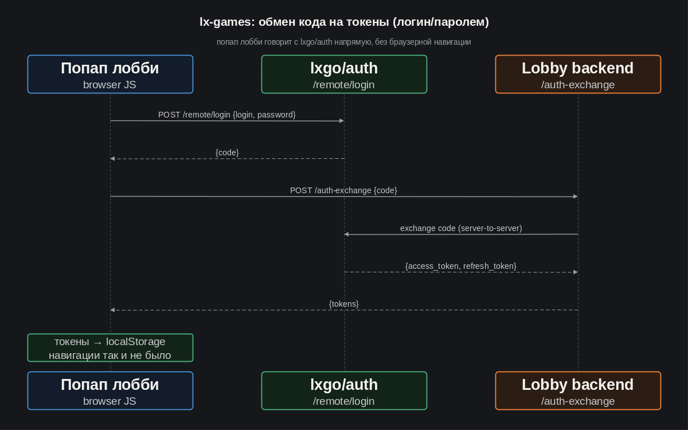

[LinkedIn](https://www.linkedin.com/pulse/lets-go-play-part-5-allow-me-introduce-myself-aleksei-sedov-tng1f/)

# "Go, поиграем! Часть 5: разрешите представиться..."

---

> #### Эпиграф
> *Не торопись, а то успеешь.*

Приветствую снова!

В [прошлый раз](https://www.linkedin.com/pulse/lets-go-play-part-4-how-we-checked-our-own-intuition-aleksei-sedov-qmdnf/)
мы подступились к онлайн-режиму Outposts of the Void: лобби↔картридж
уже знают, как разговаривать, осталось синхронизировать партию между
игроками. Соответственно, работу с этими самыми "игроками" надо
организовать с самого начала, т.е. первым делом - авторизация. Этот отчёт -
про то, как маленькая задача "добавить вход" раскрутилась в отдельный
микросервис, и почему я не стал останавливать этот снежный ком.

## Развилка у входа

Задача формулировалась просто: нужно организовать авторизацию по логину и
паролю, плюс в качестве альтернативы, в попапе входа лобби должна появиться
кнопка "Войти через Google". У меня уже есть референс - в своих прежних
проектах такой вход сделан прямо на месте, без отдельного сервиса
авторизации. Можно было скопировать тот же подход сюда - быстро, дешёво,
рабочий код уже существует.

Но с самого начала у меня была идея, что следует интегрировать `lx-games` с
имеющимся в экосистеме `lxgo` пакетом `lxgo/auth`. Это полноценный сервер
авторизации, который умеет логин/пароль, но никогда не взаимодействовал с внешними
провайдерами. У нас был выбор - обойти `lxgo/auth` и реализовать авторизацию
прямо в лобби, как я уже делал до этого, или сначала прокачать `lxgo/auth`, а
потом уже подключить лобби к готовому механизму. Первый вариант закрывал задачу за
вечер. Второй - означал переписывать половину пакета, не зная наперёд,
во что это выльется.

Я выбрал второй вариант. Не потому что первый был неправильным - он рабочий,
его даже не стыдно было бы выбрать. Просто если я делаю это руками в лобби,
оно останется привязанным к лобби. А если доработать `lxgo/auth` - этим
же механизмом сможет воспользоваться любой следующий мой сервис, которому
вдруг понадобится авторизация. Я плачу сложностью сейчас за то, чтобы
не платить ею же каждый раз заново.

## Снежный ком

Как результат, "небольшая фича" не выжила встречи с реальностью. Научить
`lxgo/auth` говорить с Google потянуло за собой то, чего у пакета раньше не было:
подтверждение почты, статус пользователя (активен/ожидает подтверждения), и
отдельный компонент для отправки писем - который дорос до нового самостоятельного
пакета `lxgo/mailer`.

Параллельно всплыла вторая проблема. У `lxgo/auth` был только один сценарий входа -
полный браузерный редирект на свою страницу с формой. Для классического сайта
это нормально. Для лобби, которое живёт как SPA и не должно никуда уходить
со страницы при входе, это означало сброс всего состояния каждый раз,
когда игрок просто хочет залогиниться. Решение этой задачи вылилось в отдельный
параллельный эпик - CORS preflight, вход без редиректа, обмен кода авторизации
на токены через JSON, сама интеграция в лобби. Плюс для удобства работы с
ещё одним микросервисом - `lxgo/auth`, понадобилась Docker-обвязка.

Два эпика, десятки задач, новый пакет, новый микросервис в архитектуре
проекта - и всё это по сути ради одной кнопки "Войти через Google", которая
могла быть реализована в течение одного вечера.

## Два входа, два решения

В итоге получилось два разных механизма - потому что у логина/пароля и
у Google разные требования.

Вход через пароль решился совсем без браузерной навигации: попап лобби
напрямую обращается к `lxgo/auth` (CORS уже настроен на это), получает
код авторизации прямо в ответе и тут же обменивает его на токены через
собственный обработчик лобби. Токены попадают в `localStorage` - и всё, страница
никуда не уходила ни на одном шаге.

С Google так не получится - у него собственная страница согласия, переход на
которую не избежать. Рассматривали полноценный попап с протоколом `postMessage`
между вкладками, но отказались: нет смысла изобретать отдельный протокол
обмена сообщениями ради одной кнопки. Итоговый компромисс: Google-вход целиком
открывается в новой вкладке, обычным полным редиректом - а исходная вкладка лобби
остаётся открытой и отслеживает, что в `localStorage` появились токены и подхватывает
их, когда браузер возвращает ей фокус. Тот же приём, кстати, обслуживает и переход
по ссылке из письма-подтверждения почты.

## Мы с Клодом концептуально не сошлись

Один момент стоит отдельной истории. Суть проблемы: чтобы дать браузеру спросить
у сервера разрешения на кросс-доменный запрос (служебный `OPTIONS`-запрос перед
настоящим POST'ом), нужно, чтобы на этот `OPTIONS` хоть что-то ответило. А у меня
роутер `lxgo/kernel` сам, ещё до любого middleware, отвечал на такой запрос
`405 Method Not Allowed` - потому что на этот путь зарегистрирован только POST.
Ни одна настройка внутри `lxgo/cors` не могла это перехватить: решение физически
не успевало сработать раньше отказа.

Чтобы это вообще стало возможным, пришлось поменять саму сигнатуру промежуточного
обработчика во всём фреймворке - теперь middleware умеет не просто пропустить запрос
дальше или оборвать его ошибкой, а вернуть готовый ответ самостоятельно.

Здесь мы с Claude (напоминаю, что весь этот код пишется именно в такой связке)
немного разошлись. Мой электронный коллега видел ситуацию, как "небольшая на вид
правка на самом базовом уровне платформы - ради одной частной фичи в другом её пакете".
Его тревожил вопрос - "не слишком ли сильный лом для одного гвоздя?" - осторожность,
абсолютно правильная для кода с реальными внешними потребителями: тронул общую сигнатуру -
и неизвестно, чей код где-то там сломался. Но у моего фреймворка пока что потребители -
только мои же проекты. Значит и тревога должна быть другой: не "не сломаю ли я кого-то",
а "не упускаю ли я окно, которое само закроется, как только появится первый внешний
потребитель". Пока я могу контролировать весь зависимый код, расширение базовой
функциональности и повышение гибкости платформы рассматриваю как благо.

С Клодом было достаточно обозначить разницу в контексте, и выяснилось, что мы вовсе не
спорили о ценностях, просто ориентировались на разные ситуации. В итоге сошлись, что
инвестируем в платформу сейчас, пока это дёшево.

## Что дальше

За этот проход, помимо самого `lx-games`, свои изменения получили пакеты : `lxgo/kernel`,
`lxgo/cors`, `lxgo/jspp`, `lxgo/session`, `lxgo/auth_client`, `lxgo/auth`. И даже
появился дебютант - `lxgo/mailer`. У лобби теперь настоящий попап входа вместо прежней
заглушки.

Пополнился и бэклог: например, сейчас нет способа вручную слить два аккаунта, если
один и тот же человек успел завестись по паролю, не сообщив e-mail, и через Google;
пока что нет механизма смены пароля. И некоторые другие вещи, к которым мы вернёмся
уже несколько позже.

Следующий логичный шаг - это механика создания игровых комнат, взаимодействие игроков в
контексте комнат - создание игр, присоединение к играм как игрок или как наблюдатель,
приглашение в приватные игры. Но самое главное, что теперь у нас есть игроки, и мы стали
ещё на шаг ближе к тому, ради чего всё затевалось - Outposts of the Void готовится стать
по-настоящему многопользовательской.

Для удобства, продублирую важные ссылки:
* Фреймворк - [https://github.com/epicoon/lxgo](https://github.com/epicoon/lxgo)
* Игровой движок - [https://github.com/epicoon/lx-games](https://github.com/epicoon/lx-games)

Спасибо, что читаете - и, как обычно, буду рад комментариям и вопросам `:)`
